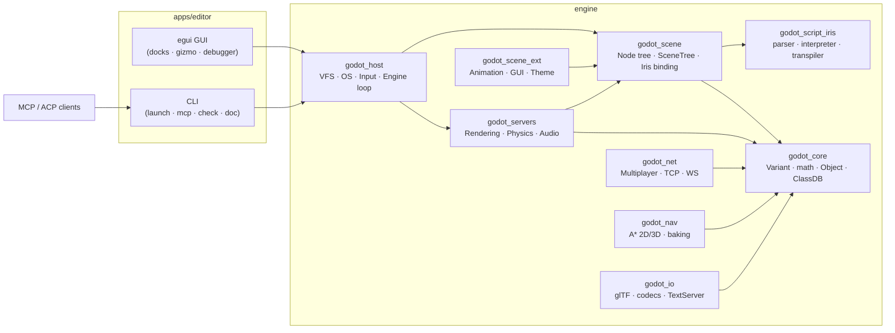

# godot_rs — Godot 4.7, re-implemented in Rust, AI-ready


A module-by-module Rust port of the [Godot 4.7](https://godotengine.org) engine
(`../godot-4.7/`, ~14k files), built the way [SolidCraft](https://github.com/tangency-labs/solidcraft)
builds CAD (Cargo workspace, ACP agent chat + model picker, MCP server) and
[ArtCraft](https://github.com/storytold/artcraft) builds creative tools
(provider/model catalog).

It runs two ways: a **Godot-style GUI editor** (scene docks, viewports,
Inspector, Play) and a **headless engine** that AI agents drive over MCP —
both on top of the same `SceneTree`, so anything an agent builds is exactly
what you see in the editor.

```bat
rem From godot_rs\ — builds on first run, then opens the GUI editor:
launch_engine.bat
```

```sh
cargo run -p editor -- launch 240   # headless: boot engine, run 240 frames
cargo run -p editor -- mcp          # serve the MCP endpoint over stdio
cargo test --workspace              # 103 tests, all green
```

> **Requires Rust 1.99+** (`rustup update`). Windows is the primary target;
> everything except the GUI also builds anywhere Cargo does.

---

## The editor

```
┌─ File  Scene  Project  Debug  Editor  Help ────────────────────────────────┐
│        [2D] [3D] [Script] [Game] [AssetLib]      ▶ ⏸ ⏭  ·  120 frames    │
├───────────────┬───────────────────────────────────┬────────────────────────┤
│ Scene         │  2D canvas / 3D viewport /        │ Inspector              │
│  Mover [2D] 📜│  software or wgpu framebuffer,    │  Node · Transform ·    │
│  StaticBody   │  grid · gizmo (Q/W/E/R) ·         │  Groups · Node (sigs)  │
│               │  view cube · snap                 │                        │
│ FileSystem    │  Script editor (Iris/GDScript→Iris│  Animation player      │
│  res://       │  check, attach, run)              │  Debugger (trace)      │
├───────────────┴───────────────────────────────────┴────────────────────────┤
│ Output │ Debugger │ Animation              frames · nodes · draws · tris  │
└────────────────────────────────────────────────────────────────────────────┘
```

- **2D screen** — pan (MMB/Space-drag), zoom-to-cursor, grid, drag-to-move nodes, Q/W/E/R transform gizmo.
- **3D screen** — orbit/pan/zoom camera rig, perspective + orthographic, grid overlay, view cube, click-to-inspect, scripted + simulated motion.
- **Script screen** — full Iris editor with `check` diagnostics, GDScript import, per-node attach & run.
- **Game screen** — runs the project with WASD/arrows/space routed into `ui_*` input actions.
- **Project management** — New/Open/Save scenes as `.tscn.json` (`PackedScene`), project + editor settings persisted to `user://`.

## Scripting: Iris (GDScript's successor here)

A small, deterministic language designed so LLMs generate it reliably —
braces, 9 statement forms, Godot Variant types, machine-readable diagnostics:

```iris
node Mover : Node2D {
  prop speed: float = 200.0
  fn _process(dt: float) {
    position.x += speed * dt
    if position.x > 500 { position.x = 0 }
  }
}
```

`position.x += speed * dt` genuinely moves the node: the engine presets node
properties as script variables before each frame and writes them back after.
There is also a **GDScript→Iris transpiler** (`gdtranspile`, AssetLib dock →
“Transpile demo.gd”, MCP `gd_transpile`) covering the everyday subset —
`docs/GDSCRIPT_COVERAGE.md` lists exactly what converts and what is honestly
rejected (`await`/coroutines, lambdas, `match` bindings, `is`, node `$`-refs).

## AI-native by construction

| Surface | What it is |
|---|---|
| `editor mcp` | JSON-RPC 2.0 over stdio: `inspect`, `execute`, `set_parameter`, `render`, `render_gpu`, `physics3d_step`, `physics2d_step`, `audio_sine`, `iris_doc`, `nav_path`, `nav_bake`, `import_gltf`, `gd_transpile`, `export` — against the **live** scene + servers |
| `editor agents` | ACP agent table (Claude Code, Codex, OpenCode, Grok, Copilot, custom) with install commands — SolidCraft-style AI → Refresh |
| `editor models` | Model dropdown presets (Ollama, LM Studio, OpenAI, OpenCode Go) with per-agent last-choice memory |
| `editor doc` | Dumps `docs/api/` (`classdb.json`, `classes.txt`, `iris.json`, `mcp_tools.json`) for agents and humans |

## Architecture



---

## What works today

- [x] **Core value layer** — all 37 `Variant` types with GDScript operator semantics, full math suite (vectors, Basis/Quaternion round-trips verified), interned `StringName`/`NodePath`, typed arrays/dictionaries, signals/groups, global `ClassDB` with JSON export.
- [x] **Scene graph** — unique-name validation, path resolution (`/root/A`, `..`, `%Unique`), reparenting, groups, timers, deferred calls, `PackedScene` save/load, per-frame Iris execution with prop write-back.
- [x] **Rendering** — RID resources, software rasterizer (deterministic, tested), **wgpu offscreen backend** (verified on device, bit-identical frames), perspective + orthographic cameras, culling, stats.
- [x] **Physics** — SAT box-box, exact capsules, static planes/boxes, body–body impulse response with friction, fixed + hinge joints, `CharacterBody3D::move_and_slide` (slide/floor/snap), sleeping with resting contacts, analytic raycasts.
- [x] **Audio** — dummy 44.1 kHz clock, buses (volume/mute/solo/meters), sine/square/noise/PCM streams, `render_pcm` mixing, WAV-16 encode/decode, OGG Vorbis decode.
- [x] **Iris v1** — full expressions, member/index assignment, bounded loops, 13 builtins, `check` diagnostics, `doc_json` schemas, GDScript transpiler + coverage doc.
- [x] **Host** — `res://`/`user://` VFS, OS/Time, input action map, project + editor settings, headless `Engine::iteration`.
- [x] **Net** — authority-checked RPC (broadcast/targeted/loopback), length-prefixed TCP transport, WebSocket channels, UPnP stub.
- [x] **Navigation** — 2D grid A* with obstacle baking, 3D waypoint-graph A* with triangle baking.
- [x] **I/O** — glTF JSON + `.glb` containers + external `.bin`, PNG/JPEG, BMP, WAV/OGG, rustybuzz shaping with system-font discovery (monospace fallback kept deterministic).
- [x] **GUI + AI** — the editor above; 15-tool MCP server; ACP agent table; model presets; `editor doc` generator.

## Honest roadmap (what's still ahead)

- [ ] **Native wgpu viewport** — today wgpu renders offscreen and the GUI shows the read-back texture; a direct swapchain view removes that copy.
- [ ] **Rotational physics** — bodies are axis-aligned (no angular state); SAT is exact within that model. Full rigid-body rotation + a Jolt backend is the biggest remaining engine chunk.
- [ ] **Recast navmesh baking** — query side (A*/string-pulling) is done; voxel-based mesh import is not.
- [ ] **MP3, FBX/Collada, `.bin` streaming, WebSocket handshake, WebRTC** — documented stubs with conversion paths.
- [ ] **GDScript coroutines/`await`, `$`-refs, full stdlib** — see `docs/GDSCRIPT_COVERAGE.md`; the transpiler grows toward these.
- [ ] **Export templates / platform ports** — desktop Windows first; Linux/macOS need windowing/driver CI.
- [ ] **Editor depth** — shader editor, animation curve editing, visual debugger breakpoints (today: trace-based), asset store.

Each crate's README documents its own scope, API example, and verify command;
`docs/PORT_PLAN.md` tracks the 12-module map, `docs/IRIS_SPEC.md` is the Iris
reference, and `docs/GDSCRIPT_COVERAGE.md` is the transpiler contract.

## Layout

| Crate | Godot original | Tests |
|---|---|---|
| `godot_core` | `core/variant,object,math,string,templates,error` | ✅ 19 |
| `godot_scene` | `scene/main`, `scene/2d,3d`, `PackedScene` | ✅ 15 |
| `godot_scene_ext` | `scene/animation,gui,theme,resources` | ✅ 6 |
| `godot_script_iris` | `modules/gdscript` + `modules/mono` → **Iris** | ✅ 9 |
| `godot_servers` | `servers/rendering,physics_*,audio` (+`wgpu` feat: 20) | ✅ 18 |
| `godot_host` | `core/io,os`, `platform/*`, `main/*` | ✅ 6 |
| `godot_net` | `modules/multiplayer,websocket,upnp` + TCP | ✅ 8 |
| `godot_nav` | `servers/navigation_*`, baking | ✅ 7 |
| `godot_io` | `modules/gltf`, codecs, `servers/text` | ✅ 12 |
| `godot_ai` | ACP client + model registry + MCP server | ✅ 3 |
| `apps/editor` | `editor/` GUI + headless shell | CLI verbs |

```sh
cargo test --workspace                       # 103 tests
cargo test -p godot_servers --features wgpu  # +2 GPU tests
cargo check -p editor --features gui         # GUI build
cargo run -p editor -- doc                  # regenerate docs/api/
```

Dual-licensed MIT / Apache-2.0 at your option. Godot itself is MIT-licensed
([godotengine.org](https://godotengine.org)); SolidCraft/ArtCraft architecture
references are theirs — this port is an independent implementation.
